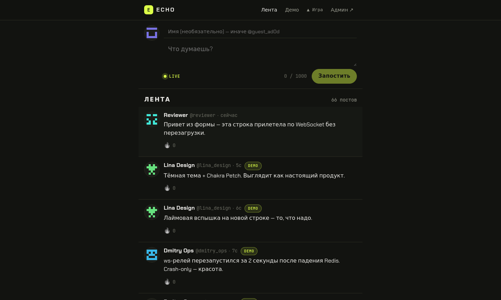
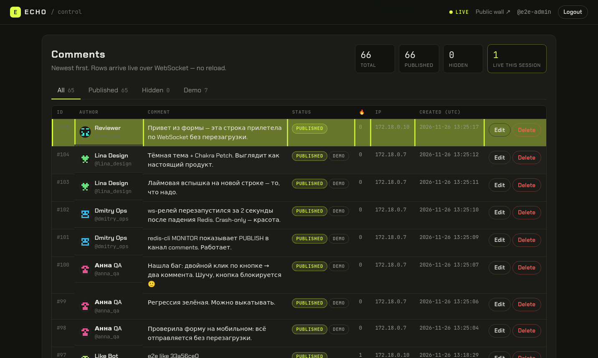
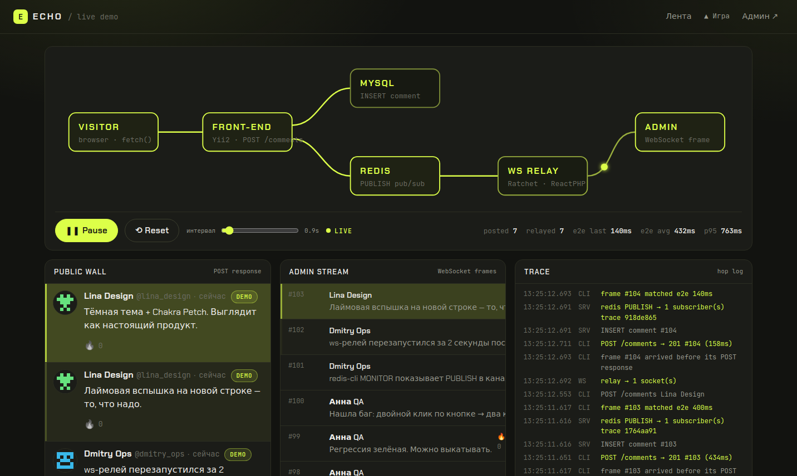
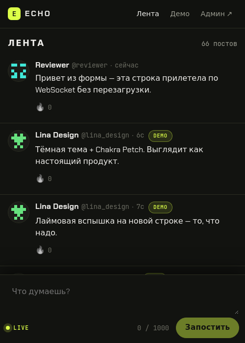
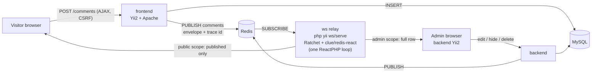

# Echo: a real-time comment wall on Yii2

Visitors post on a public wall **without logging in**. Administrators log in, moderate the comments
(edit, hide, delete) and see every new comment **arrive in their list live over WebSockets**.
The whole system runs in Docker and is covered by **unit, smoke, regression and end-to-end tests**.
The tests are traced step by step to the pipeline they protect.

> Site.pro / Borcov Group homework `#php`. Author: Shahzod (QA Automation / SDET).

| Public wall (desktop) | Admin: a row that just arrived over the WebSocket |
|---|---|
|  |  |

| `/demo`: the real pipeline, self-playing | Mobile |
|---|---|
|  |  |

---

## Contents
1. [Quick start](#1-quick-start)
2. [Requirements → where they are met](#2-requirements--where-they-are-met)
3. [Architecture](#3-architecture)
4. [**Review walkthrough: one comment from the form to the admin list**](#4-review-walkthrough-one-comment-from-the-form-to-the-admin-list)
5. [**Test suites: what, how, when, organisation, scaling**](#5-test-suites)
6. [Test intelligence: a suite that learns and grows](#6-test-intelligence-a-suite-that-learns-and-grows)
7. [For AI agents: MCP server, slash commands, sub-agent](#7-for-ai-agents)
8. [Demo mode](#8-demo-mode)
9. [Bugs the tests caught while building this](#9-bugs-the-tests-caught)
10. [Configuration, layout, limitations](#10-configuration-layout-limitations)

---

## 1. Quick start

Requires only Docker. There is no PHP or Composer on the host; everything runs in containers.

**No Docker? Run it in the browser:** [](https://codespaces.new/schzd/site-pro-comments). The devcontainer (`.devcontainer/`) starts the whole stack on its own; open port **20080** (wall) and **21080** (admin) from the Ports tab. The first start takes ~3–5 minutes (composer install). Tests run there the same way.

```bash
git clone <this repo> && cd site-pro-comments
docker compose up -d          # mysql, redis, setup (composer + init + migrations + admin), frontend, backend, ws
```

| | URL | |
|---|---|---|
| Public wall | http://localhost:20080 | post without logging in |
| Admin panel | http://localhost:21080 | **admin / admin12345** |
| WebSocket | `ws://<page host>/ws/` | same origin as the page: Apache tunnels `/ws/` to the relay (`ws:8080`), so it works behind HTTPS and in Codespaces too |
| Live demo | http://localhost:20080/demo | press **▶ Play Demo** |
| Easter egg | http://localhost:20080/game/ | *Pegasus Dodge*, a branded three.js mini-game |

Try the core requirement: open the admin panel and the wall side by side, then post on the wall.
The row slides into the admin table with a lime flash, with no reload. The admin's edits and deletes then
appear on every open wall the same way.

**Run the tests** (isolated test stack: its own database schema, Redis channel and app containers, plus Selenium):

```bash
docker compose --profile test up -d
docker compose run --rm tester all        # unit → smoke → regression → e2e
```
To watch the E2E browser live, open http://localhost:7900 (noVNC, password `secret`) during `tester e2e`.

---

## 2. Requirements → where they are met

| Homework requirement | Implementation | Locked by |
|---|---|---|
| Front-end: post **without logging in**, post appears in the feed | `frontend/controllers/CommentController.php` (AJAX + no-JS fallback), `frontend/views/comment/*`, `frontend/web/js/wall.js` | S1–S4 below |
| Admin: **login**, **list**, **edit**, **delete** | `backend/controllers/{Site,Comment}Controller.php`, `backend/views/comment/*` | S7–S9 |
| New comment appears in the admin list **in real time via web-sockets** | Redis pub/sub → `php yii ws/serve` (Ratchet + clue/redis-react) → `backend/web/js/admin-live.js` | S5, S6, S8 |
| **Whole project in Docker** | `docker-compose.yml`: mysql, redis, setup, frontend, backend, ws (+ test profile) | Smoke suite runs against the containers |
| **Unit, smoke, e2e, regression** tests, each explained | [§5](#5-test-suites) | 145 tests, all green (output in §5) |
| **Walk one comment** from the form to the admin list and name the test that locks each step | [§4](#4-review-walkthrough-one-comment-from-the-form-to-the-admin-list) and the generated [docs/TRACEABILITY.md](docs/TRACEABILITY.md) | `qa matrix --strict` |

---

## 3. Architecture



**Design decisions**

* **Persist first, then publish, exactly once.** Every state change goes through `common/services/CommentService.php`.
  Publishing is explicit, not hidden in ActiveRecord events, so fixtures and migrations never emit live events.
* **No silent fallbacks.**
  * Configuration is environment-only. `common/helpers/Env.php` stops the app at boot if a variable is missing or malformed.
  * A Redis outage never loses a comment, and it is never hidden either. The API returns
    `realtime: {delivered: false}`, the event is logged, and the admin's `LIVE` indicator goes `offline`.
  * `PUBLISH` returns its subscriber count. `subscribers: 0` distinctly means "Redis is up but the relay isn't listening".
* **Same-origin WebSocket.** Browsers connect to `/ws/` on the page's own host, and each app's Apache (`mod_proxy_wstunnel`) tunnels it to the relay. One origin, `wss://` behind HTTPS, no extra port to expose. The relay port 8080 stays published for direct debugging.
* **Crash-only relay.** If the Redis connection drops, `ws/serve` exits non-zero and Docker restarts it. Browsers reconnect with backoff.
* **Signed, scoped, short-lived socket tokens** (`SocketTokenService`, HMAC-SHA256, 60 s TTL, handshake only).
  * `admin` scope: receives every event with private fields (IP, hidden rows).
  * `public` scope: receives only published comments, stripped to `RelayHub::PUBLIC_FIELDS`.
  * Hiding a comment reaches public sockets as a deletion.
  * The relay never touches the database or the sessions.
* **A trace id on every event.** The id in the HTTP response matches the one on the WebSocket frame, so tests (and `/demo`)
  can correlate a POST with the frame it caused and measure real end-to-end latency.
* **Keyset pagination** (`created_at, id` cursor). "Load more" never repeats or skips rows while new posts land at the top.
  Ties within one second are broken by `id`.
* **One markup source per card.** `_card.php` / `_row.php` render server-side and also as a `<template>` that the live JS clones.

---

## 4. Review walkthrough: one comment from the form to the admin list

One comment, followed through the nine steps of the pipeline (`qa/steps.php`). Every test is tagged
`@group step-Sx`, so each step can be re-run in isolation: `docker compose run --rm tester regression -g step-S5`.
The full, always-current matrix (every test, with its last result) is generated into [docs/TRACEABILITY.md](docs/TRACEABILITY.md).

| # | What happens to the comment | Code | **Locked by** (key tests) |
|---|---|---|---|
| **S1** | A visitor opens `/`. The composer renders with no login, no password field, a CSRF token and a socket-token URL. | `frontend/views/comment/index.php` | Regression `WallCest::wallRendersComposerWithoutLogin` · Smoke `PipelineSmokeCest::wallIsUpAndOffersTheComposer` · E2E `LiveCommentFlowCest` (asserts no password field) · E2E `PublicWallLiveCest::mobileComposerDocksToTheBottom…` |
| **S2** | They type and press **Запостить**. `wall.js` POSTs to `/comments`. The server normalises (trim, control characters, CRLF) and validates (lengths in characters, not bytes). A blank name becomes a stable `guest_xxxx`. `status`, `ip`, `likes` and `is_demo` cannot be injected. CSRF is enforced. | `common/models/Comment.php`, `frontend/controllers/CommentController.php` | Unit `CommentValidationTest` (14 cases) · Unit `InputInvariantsTest` (property-based, hostile Unicode, self-growing corpus) · Regression `WallCest::invalidPostIsRejectedWith422…`, `…privilegedFieldsCannotBeInjected`, `…requestWithoutCsrfTokenIsRefused` · Smoke `postWithoutCsrfIsRefused` · E2E `composerBlocksEmptyPostsAndShowsServerErrors` |
| **S3** | `CommentService::create()` saves it in MySQL as `published` with the client IP. | `common/services/CommentService.php` | Unit `CommentServiceTest::testCreatePersistsThenPublishesOnce`, `…RelayOutageNeverLosesTheComment` · Regression `WallCest::ajaxPostPersistsAndPublishesOnce` (asserts the DB row) · Smoke `postIsAcceptedAndReachesTheRelay` |
| **S4** | It appears at the top of the public feed: newest first, HTML escaped, deterministic identicon, `@handle`. Other visitors receive it live, and readers who have scrolled down get a "↑ N новых" pill. | `_card.php`, `CommentQuery`, `Handle`, `Avatar`, `wall.js` | Unit `CommentQueryTest` (id tie-break, keyset) · Regression `WallCest::feedIsNewestFirst…`, `…markupInCommentsIsRenderedAsText`, `…loadMoreNeverDuplicatesWhileNewCommentsArrive` · Smoke `postedCommentIsInThePublicFeed` · E2E `PublicWallLiveCest::otherVisitorsSeeNewPostsLive`, `…scrolledReaderGetsNewPostsPill` |
| **S5** | The service publishes `comment.created` on the Redis channel. The v1 envelope carries the full admin row and a trace id, and the response reports `delivered` and `subscribers`. | `common/realtime/{Envelope,RedisCommentEventPublisher}.php` | Unit `EnvelopeTest` (wire format, rejects garbage) · Unit `RedisCommentEventPublisherTest` (0 subscribers, outage) · Regression `WallCest::relayOutageIsReportedButCommentIsKept` · Smoke `postIsAcceptedAndReachesTheRelay` (**subscribers ≥ 1** on the real Redis) |
| **S6** | The relay receives it and fans it out per scope. Admin sockets get the full row; public sockets get the projection. Sockets without a valid token are closed with code **4401**. | `common/realtime/RelayHub.php`, `console/controllers/WsController.php` | Unit `RelayHubTest` (11 cases with fake Ratchet connections) · Unit `SocketTokenServiceTest` (expiry, forgery, privilege escalation) · Smoke `relayRejectsSocketsWithoutValidToken`, `relayClosesTokenlessSocketWith4401`, `relayGreetsPublicSocket`, `relayIsReachableSameOriginThroughBothApps` (the Apache `/ws/` tunnel the browsers use) |
| **S7** | The administrator signs in at `/login` and the page fetches an **admin-scope** token from `/ws-token`. | `backend/controllers/SiteController.php` | Regression `AdminCest::guestsAreSentToLogin`, `…wrongPasswordIsRejected`, `…adminSocketTokenCarriesAdminScopeAndUserId` · Smoke `adminLoginPageIsUp` · E2E `LiveCommentFlowCest` (real login) |
| **S8** | **The row appears in the admin list without a reload**, flashes lime, and the counters update. | `backend/web/js/admin-live.js`, `_row.php` | Smoke **`adminSocketReceivesTheNewCommentLive`** (raw WebSocket: the frame with the *same trace id*, private fields included) · Regression `AdminCest::listIsNewestFirst…` · E2E **`LiveCommentFlowCest::commentTravelsFromFormToAdminListLive`** (two tabs, a real browser; asserts the row arrives, carries `is-new`, and that a JS marker survived, so the page provably never reloaded) |
| **S9** | The admin edits, hides or deletes it. Each change is published again, and every open wall and admin page follows live. | `CommentService::update/delete`, backend views | Unit `CommentServiceTest::testUpdatePublishesTheNewState`, `…DeletePublishesIdAfterRemoval` · Regression `AdminCest::editSavesAndPublishesUpdate`, `…hidingAPublishedComment…`, `…deleteIsPostOnlyCsrfProtected…` · E2E `LiveCommentFlowCest` (edit, then delete, while the visitor's tab updates) |

The walkthrough can also be replayed live by an AI agent: `/walkthrough` (see [§7](#7-for-ai-agents)).

---

## 5. Test suites

```
docker compose run --rm tester unit          #  92 tests   ~8 s   no network services
docker compose run --rm tester smoke         #  12 tests   ~10 s  needs: docker compose --profile test up -d
docker compose run --rm tester regression    #  34 tests   ~15 s
docker compose run --rm tester e2e           #   7 tests   ~45 s  real Chromium
docker compose run --rm tester all           # gate order, stops at the first red suite
docker compose run --rm tester regression -g step-S9 --filter delete -v    # any codecept args
```

The four suites test four different things, using four different mechanisms:

| | **Unit** | **Smoke** | **Regression** | **E2E** |
|---|---|---|---|---|
| **What it is for** | Business rules and protocols in isolation: validation, normalisation, envelope, tokens, relay routing, the service's persist-then-publish contract. | "Is the deployed thing alive end to end?" Every critical path answers on the real containers. | Full behavioural contract of both apps, including every bug fixed so far. Guards against breaking something that once worked. | What a human actually experiences: two browsers, two origins, live updates, no reloads, mobile layout. |
| **How it works** | Codeception/PHPUnit in `common/tests/Unit`. Real MySQL for ActiveRecord. Redis and Ratchet replaced by hand-written fakes. A property-based test with a seed and a corpus. | `blackbox/tests/Smoke`: PhpBrowser over **real HTTP** to `frontend-test` / `backend-test`, plus a minimal **RFC 6455 client** to `ws-test`. Opens an admin socket, posts, waits for the frame with the same trace id. | Codeception **Yii2 module in-process** (`frontend|backend/tests/Regression`): real routing, filters, CSRF, MySQL, a fresh app per request. The publisher is a **spy**, so every expected event is asserted. | `blackbox/tests/E2E`: Codeception **WebDriver → Selenium Chromium**. A fresh browser session per test. |
| **When it runs** | Every commit / pre-push (seconds, no services). | Every push and every deployment, as the quick gate (~10 s). | Every pull request, nightly, before a release. | Pull requests that touch UI or real-time code (`qa plan` decides), nightly, before a release. |
| **Data** | `yii2advanced_unit`, fixtures per test | `yii2advanced_e2e`, unique markers only, never truncates | `yii2advanced_regression`, fixtures per test | shared with smoke, unique markers |
| **Organising the runs** | `-g step-Sx`, `-g property`, `--filter` | `-g step-Sx` | `-g step-Sx`, `-g demo` | `-g step-Sx`, `-g demo`; quarantined tests are skipped by the gate but reported |
| **Scaling** | `qa shards --suite=unit --n=N`, with one container and its own auto-created schema per shard (`QA_WORKER=wN`) | stateless: run any number in parallel | shards + `QA_WORKER` schemas | shards; `SE_NODE_MAX_SESSIONS` or a Selenium Grid for more browsers |

**Organisation in one line.** Suites are physically separate (one directory and one database per suite), and logically tagged by
pipeline step. So a run can be sliced either way: by layer (`tester unit`) or by feature across layers (`-g step-S5`).

**Scaling, demonstrated.** Duration-balanced shards are computed from recorded history, then run in parallel containers.
Each container creates its own schema on the fly:

```text
$ docker compose run --rm tester qa shards --suite=unit --n=2
$ docker compose run --rm -e QA_WORKER=w1 tester unit -g qashard_unit_1 &
$ docker compose run --rm -e QA_WORKER=w2 tester unit -g qashard_unit_2
[tester] database: yii2advanced_unit_w1      OK (17 tests, 2573 assertions)
[tester] database: yii2advanced_unit_w2      OK (75 tests, 164 assertions)
```

In CI the same shards become a job matrix (`.github/workflows/ci.yml`). Codeception's built-in `--shard i/N` also works.
The `qa` shards balance by measured time rather than by count.

**Latest full run** (`docker compose run --rm tester all`, real output):

```text
================================================================ unit
OK (92 tests, 2767 assertions)
================================================================ smoke
OK (12 tests, 41 assertions)
================================================================ regression
OK (21 tests, 78 assertions)        # frontend
OK (13 tests, 44 assertions)        # backend
================================================================ e2e
OK (7 tests, 41 assertions)
recorded 115 results at revision …; 0 flaky test(s) quarantined
```

---

## 6. Test intelligence: a suite that learns and grows

The suites describe themselves and adapt. Everything derives from one registry, [`qa/steps.php`](qa/steps.php),
which lists each pipeline step with its routes, code paths and *required* suites. It also uses the `@group step-*` tags in the tests.
The tool is [`qa/qa.php`](qa/qa.php): dependency-free PHP, run as `docker compose run --rm tester qa <command>`.

| Command | What it does | Why it matters |
|---|---|---|
| `matrix [--strict]` | Builds step → guarding tests → last result, and writes [docs/TRACEABILITY.md](docs/TRACEABILITY.md). `--strict` fails if a step lacks a required suite or has a red test. | The walkthrough can never go stale; it is a CI gate. |
| `record` (automatic after every run) | Learns from JUnit: average durations (EWMA), a pass/fail trail, and **flakiness**, meaning both outcomes seen on the *same* code revision. Writes `qa/history.json`. Flaky tests are auto-quarantined into a group the blocking gate skips but still reports. | Self-learning: the suite knows its slow, failing and flaky tests. |
| `plan [--base=origin/main]` | Maps `git diff` → impacted steps → the minimal `-g step-*` selection per suite, with recently failing or flaky tests first. Code that no step claims forces a **full** run. | Fast feedback that cannot under-test. |
| `gaps` | Finds routes in code that no step claims, source files no step guards, and steps missing a required suite. Exits 1 on any gap. | **When the app grows, this tells you exactly what to test.** |
| `scaffold --step --suite --name` | Generates a test pre-wired to the step (namespace, actor, `@group`). It counts as *not guarding* until implemented. | Growing the suite is mechanical, for humans and agents alike. |
| `shards --suite --n` | Duration-balanced (LPT) group files from history. | Scales to N workers evenly. |
| `history` | Lists the slowest, flaky and most-failing tests. | Shows where to invest. |

**Self-growing regression corpus.** `common/tests/Unit/Property/InputInvariantsTest.php` generates hostile inputs
(control characters, NBSP and U+2028, RTL overrides, combining marks, emoji, invalid UTF-8, payload strings) and checks
invariants: idempotent normalisation, safe handles, bounds, and byte-exact survival over the wire. Any counterexample
is **appended to [`qa/corpus/input-invariants.json`](qa/corpus/input-invariants.json)** and replayed on every run from then on,
so the suite grows from its own failures. Reproduce a run with `QA_SEED=<seed>`.

**What happens when the app changes** (verified by adding a dummy action):

```text
$ docker compose run --rm tester qa gaps
✗ Routes with no step (new feature? add to qa/steps.php):
    - frontend:site/stats
$ docker compose run --rm tester qa scaffold --step=S4 --suite=regression --app=frontend --name=StatsCest
created frontend/tests/Regression/StatsCest.php (group step-S4)
```

---

## 7. For AI agents

Open this repository in Claude Code (or any MCP client) and it is ready to explore:

* **[CLAUDE.md](CLAUDE.md) / [AGENTS.md](AGENTS.md)**: architecture, commands and the rules for extending the tests.
* **MCP server `echo-qa`** ([.mcp.json](.mcp.json) → `docker compose --profile mcp run --rm -T --no-deps mcp`, implemented in
  [`qa/mcp/server.php`](qa/mcp/server.php)). Its tools work on the *live* stack:
  * `project_overview`
  * `stack_status`: HTTP, the WebSocket hello, and the Redis subscriber count
  * `post_comment`
  * `watch_admin_socket`: posts a probe and returns the measured POST → admin-frame latency, as proof of the real-time path
  * `run_tests`
  * `qa`: gaps, plan, scaffold, matrix, shards, history
  * `explain_step`
* **Slash commands** (`.claude/commands`):
  * `/tour`: a 5-minute guided review
  * `/walkthrough`: §4, executed live with evidence
  * `/verify`: the full gate, reported honestly
  * `/extend-tests`: the app changed, so grow the suites
* **Sub-agent** `.claude/agents/test-scaler.md`: the loop gaps → claim in the registry → scaffold → implement → run → `matrix --strict`.
  An agent can extend the suites as the application evolves without having to re-learn the project.

Example MCP output from this machine:
```text
PROBE OK: "mcp probe 0dccf0" posted (HTTP 201) and arrived on the admin socket 1263 ms after the POST started,
trace 1f1f1f96bbfd1ee0, relayed to 1 socket(s).
```

---

## 8. Demo mode

`/demo` is a self-playing demonstration that **drives the real system**:

* An auto-poster cycles through simulated personas and sends **real `POST /comments` requests** (flagged `demo=1`).
  The interval is adjustable from 0.6 to 6 s.
* The SVG pipeline lights up **only on real signals**:
  * Visitor → Front-end → MySQL/Redis light when the POST actually resolves.
  * Redis → WS → Admin light when the WebSocket frame actually arrives.
* The panes:
  * **Public wall**: the same card component as `/`.
  * **Admin stream**: real frames.
  * **Trace**: a timestamped hop log, client and server clocks.
* Stats: posted, relayed, last e2e latency, average and p95.
  Frames are matched to their POST by trace id. The frame often arrives *before* the HTTP response, and both orders are handled.
* **Hygiene:** demo rows carry `is_demo` and a DEMO pill, and can be filtered in the admin.
  **Reset** deletes only demo rows (`POST /demo/reset`) and announces it, so every admin page removes them live.
  `DEMO_MODE=off` disables the page and the flag.
* Locked by Regression `DemoCest` and by E2E `DemoModeCest`. The E2E test plays the demo, checks the real admin panel,
  presses Reset, and verifies that the rows are really gone.

---

## 9. Bugs the tests caught

These were found by the suites while building the project, not seeded. Each one is now a permanent regression test.

| ID | Bug | Caught by | Now locked by |
|---|---|---|---|
| REG-001 | Un-liking a comment at `likes = 0` crashed: `GREATEST(likes - 1, 0)` overflows on an `UNSIGNED` column before `GREATEST` can clamp. | Unit `CommentServiceTest` | `testLikeCounterNeverGoesNegative` |
| REG-002 | The CSS `display` of `.pill` / `.cp-banner` overrode the `hidden` attribute, so every admin row showed a DEMO pill under an empty banner. DOM assertions were green; only the E2E screenshot revealed it. | E2E failure screenshot | E2E asserts visibility (`dontSeeElement`), plus a global `[hidden]` rule |
| REG-003 | Edit and Delete on rows that arrived live, and likes on live cards, built URLs from a non-routable placeholder (`__ID__` vs `<id:\d+>`). | E2E `LiveCommentFlowCest`, `likeIsOptimisticAndPersists` | Same tests |
| REG-004 | The relay is faster than the HTTP response: a frame can arrive before `fetch()` resolves, so the demo lost latency samples. | E2E `DemoModeCest` | Asserts every frame is matched |
| REG-005 | Russian validation messages interpolated English labels ("«Name»"). | E2E `composerBlocksEmptyPosts…` | Same test |
| REG-006 | E2E browser sessions leaked between tests: the admin cookie and the second tab carried over, causing an order-dependent failure. | `qa history` (trail `FP`) | `restart: true` per test |

---

## 10. Configuration, layout, limitations

**Configuration.** Everything is in the `x-php-env` block of `docker-compose.yml`. A missing variable stops the app at boot.

| Variable | Purpose |
|---|---|
| `DB_DSN`, `DB_USERNAME`, `DB_PASSWORD` | MySQL (the test runner switches the schema per suite / worker) |
| `REDIS_HOST`, `REDIS_PORT`, `COMMENTS_CHANNEL` | pub/sub channel (`comments`; the test stack uses `comments_e2e`) |
| `WS_LISTEN`, `WS_UPSTREAM`, `WS_PUBLIC_URL`, `WS_TOKEN_SECRET` | relay bind address, the relay address Apache tunnels `/ws/` to, the browser-facing URL (`/ws` = same origin), the HMAC secret |
| `FRONTEND_PUBLIC_URL`, `BACKEND_PUBLIC_URL` | cross-links and avatar URLs |
| `DEMO_MODE` | `on` / `off` |
| `ADMIN_USERNAME`, `ADMIN_EMAIL`, `ADMIN_PASSWORD` | seeded by `php yii seed/admin` (idempotent) |

The credentials in compose are for **development only**.

**Layout**
```
common/      models, services (CommentService), realtime (Envelope, publisher, tokens, RelayHub), helpers, theme assets
frontend/    public wall, /demo, avatars, likes       → tests/Regression
backend/     admin panel                               → tests/Regression
console/     migrations, ws/serve (relay), seed/admin
blackbox/    Smoke + E2E against the running test stack (no Yii in-process)
qa/          steps registry, qa.php, history, corpus, quarantine/shards, MCP server
docker/      setup.sh, tester/run.sh, mysql initdb (one schema per suite)
```

**Known limitations and next steps**

* There is a single relay instance. Redis pub/sub allows N relays behind a load balancer (each subscribes); this hasn't been load-tested.
* There is no rate limit on posting comments (likes are limited per IP). A Redis token bucket would be the next step.
* Ratchet 0.4.4 (the latest release) raises PHP 8.4 deprecation notices from vendor code; the relay silences only `E_DEPRECATED`.
* The UI language is deliberate: the public wall is in Russian, the admin panel in English, and the README in English.
* CI (`.github/workflows/ci.yml`) is green on GitHub for pushes (stack up → unit → smoke → `qa gaps`). The pull-request and nightly jobs (regression, sharded E2E, quarantine) have not been triggered yet; no PR has been opened.
* The Codespaces devcontainer is written and its commands are verified locally (`up --wait`, same-origin `/ws/` tunnel), but it has not been launched in a real Codespace yet.
